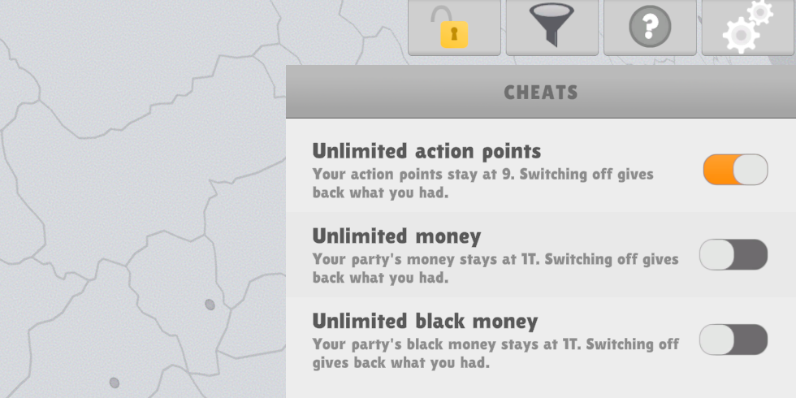

# Cheat Menu

Unlimited action points and money for Lawgivers II.

The Cheat Menu adds a padlock button to the top-right corner of the HUD, next to Filters, Help and Settings. Clicking it opens a small panel with three cheats:

| Cheat | What it does |
|---|---|
| Unlimited action points | Keeps your action points at 9. |
| Unlimited money | Keeps your party's money at 1T. |
| Unlimited black money | Keeps your party's black money at 1T. |

When you turn a cheat off, you get back whatever you had before you turned it on, even after a restart. If you save while a cheat is on, the cheated values end up in your save.

The party window's Relations tab also gets an "Edit relations" switch. While it's on, you can drag the bars to set how your party gets along with each of the others.

## Installation

The Cheat Menu needs the [Mod Library](https://github.com/Mindus1/lawgivers2-mod-library) and the [Mod Manager](https://github.com/Mindus1/lawgivers2-mod-manager).

1. Install [BepInEx 6 for IL2CPP](https://builds.bepinex.dev/projects/bepinex_be) (x64, build 790 or newer) and start the game once so it can set itself up.
2. Install the Mod Library and the Mod Manager.
3. Download `CheatMenu.dll` from [Releases](../../releases) and put it into `Lawgivers II\BepInEx\plugins`.

You can switch the whole mod off in the MODS menu without restarting. That turns every cheat off, gives you your old values back and hides the padlock.

## Documentation

The [wiki](../../wiki) explains [how the cheats work](../../wiki/Cheats), [editing relations](../../wiki/Editing-party-relations) and [how to add a cheat of your own](../../wiki/Adding-a-cheat).

## License

[MIT](LICENSE)
